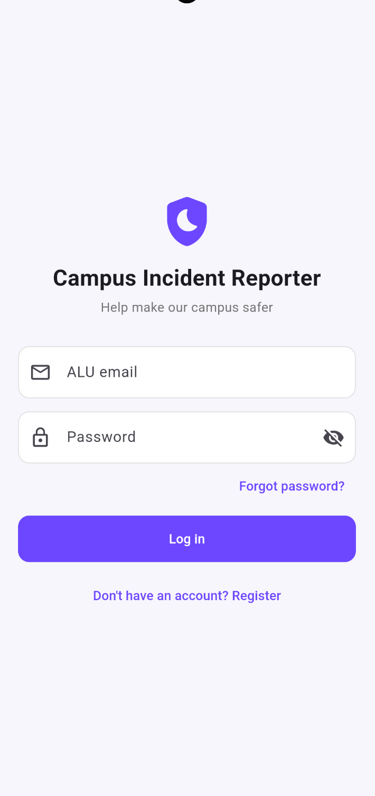
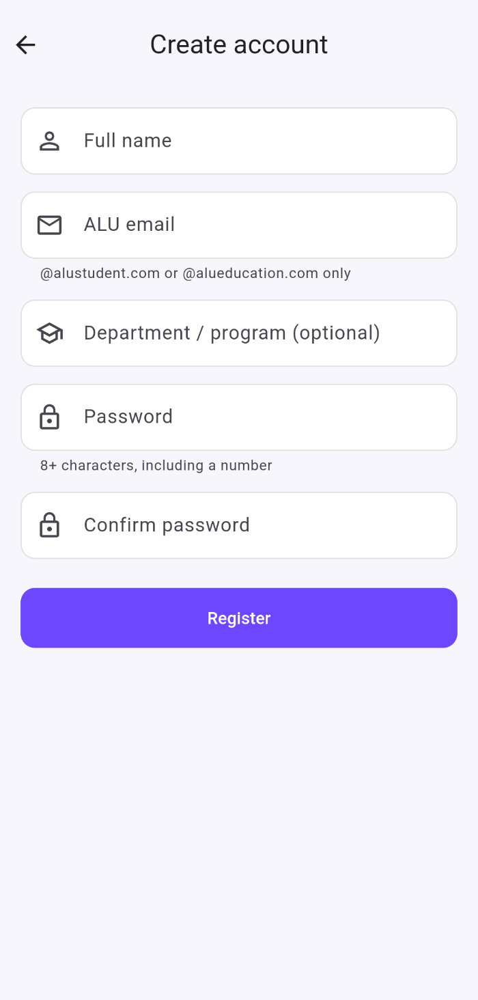
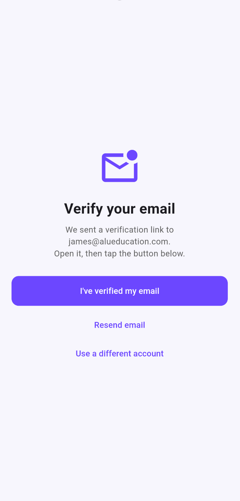
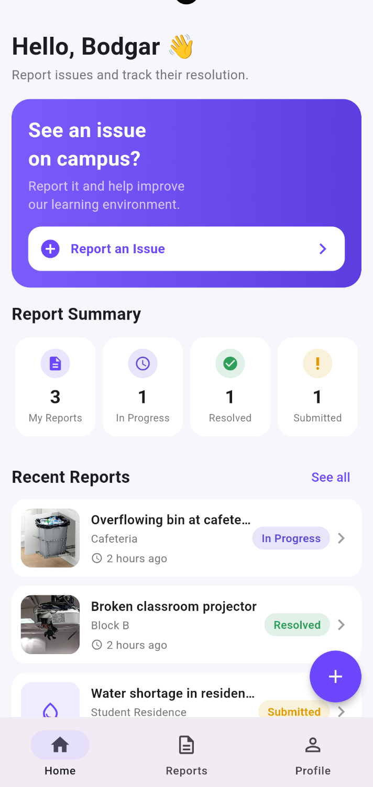
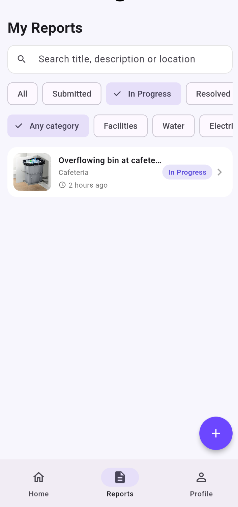
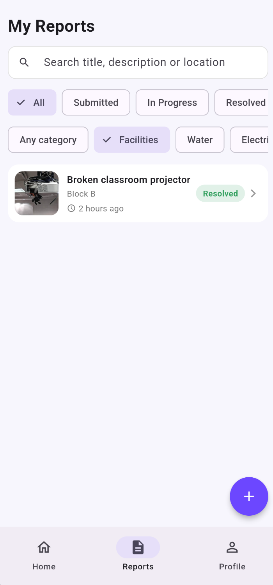
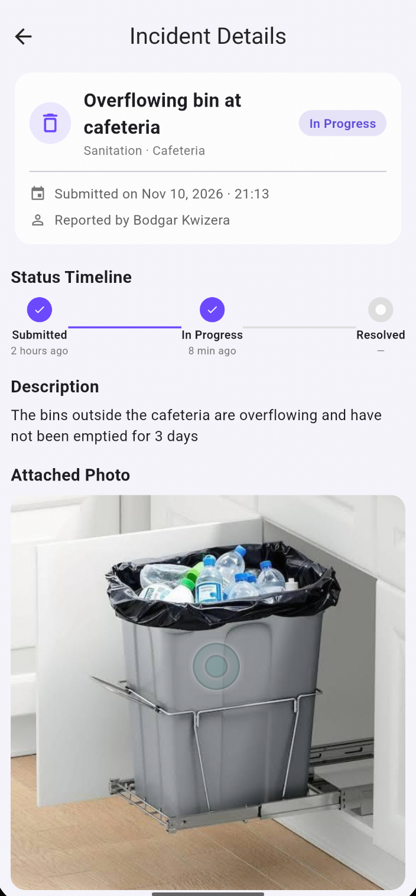
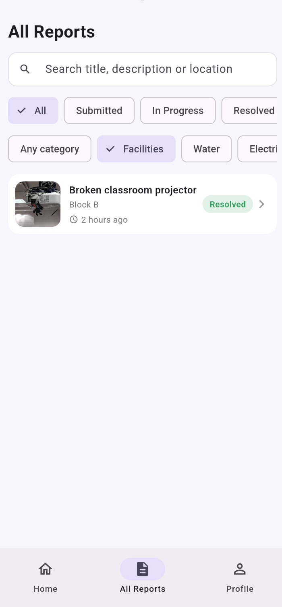
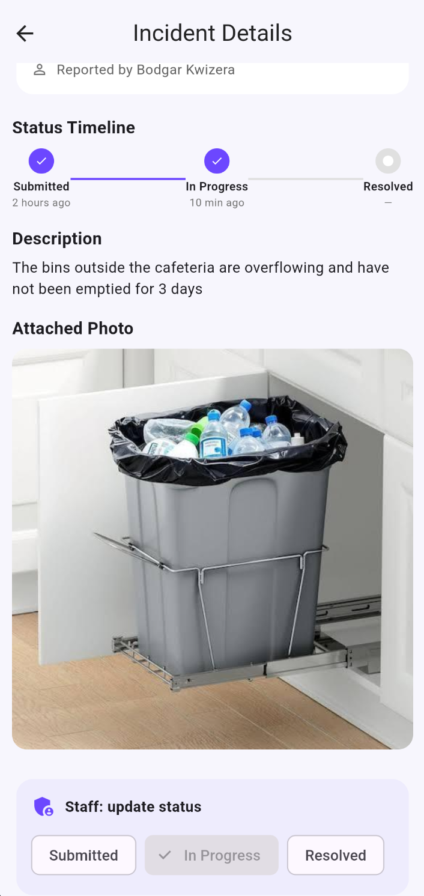

# Campus Incident Reporter

A Flutter mobile app where students report campus issues (facilities, water, electricity, safety, sanitation) and authorized staff review reports and update their status.

**Stack:** Flutter · Provider (state management) · Firebase Authentication · Cloud Firestore · Cloudinary (photo hosting)
**Tested on:** Android emulator (Pixel 8)

> Firebase Storage requires the paid Blaze plan, so incident photos are uploaded to Cloudinary's free plan instead. The image URL is stored in Firestore.

## Features
- Email/password sign-up restricted to ALU domains (`@alustudent.com`, `@alueducation.com`), with **mandatory email verification**
- Two roles: **student** (report; edit or delete own reports while still *Submitted*) and **staff** (see all reports, update status)
- Report an incident: category, title, description, location, optional photo (camera or gallery)
- Browse, search and filter reports (status and category); details screen with a status timeline
- Real-time updates from Firestore; loading, empty and error states; form validation
- Server-side access control in [`firestore.rules`](firestore.rules)

## Screenshots
| Login | Register | Verify email | Student home |
|---|---|---|---|
|  |  |  |  |

| Status filter | Category filter | Details + timeline | Staff: all reports | Staff: update status |
|---|---|---|---|---|
|  |  |  |  |  |

## Project structure
```
lib/
  core/        constants, theme, validators, utils, cloudinary_config
  models/      AppUser, Incident, StatusEvent
  services/    AuthService, IncidentRepository (Firestore), StorageService (Cloudinary)
  providers/   AuthProvider, IncidentProvider (ChangeNotifier)
  screens/     auth/, home/, incidents/, profile/, auth_gate.dart, main_shell.dart
  widgets/     reusable UI components
test/          validator, model, filter and upload tests
docs/          technical report draft, demo script, screenshots
firestore.rules
```
Data flow: **Widget → Provider → Repository / Service → Firebase / Cloudinary**. Widgets never call Firebase directly.

## Setup
Prerequisites: Flutter SDK, an Android emulator or phone, a Google account, a free Cloudinary account.

### 1. Create the Firebase project
1. [console.firebase.google.com](https://console.firebase.google.com) → **Add project**.
2. **Authentication** → Get started → **Email/Password** → enable.
3. **Firestore Database** → Create database → production mode.
4. Do **not** enable Firebase Storage (needs a paid plan).

### 2. Connect the app to Firebase
```bash
curl -sL https://firebase.tools | bash        # install Firebase CLI
firebase login
dart pub global activate flutterfire_cli
export PATH="$PATH":"$HOME/.pub-cache/bin"
firebase projects:list                        # copy the exact Project ID
flutterfire configure --project=<project-id> --platforms=android --yes
flutter pub get
```
This regenerates `lib/firebase_options.dart` and `android/app/google-services.json`.
For iOS, add `ios` to `--platforms` (needs `gem install xcodeproj` and Xcode).

### 3. Publish the Firestore rules
Firebase console → Firestore → **Rules** → paste the contents of `firestore.rules` → **Publish**.

### 4. Set up Cloudinary (photos)
1. Sign up at [cloudinary.com](https://cloudinary.com) and copy your **Cloud name** from the dashboard.
2. Settings (gear) → Upload → **Add upload preset**: name it, set **Signing mode: Unsigned**, folder `incident_photos`. Save.
3. Put both values in `lib/core/cloudinary_config.dart`. Never put the API secret in the app.

### 5. Run
```bash
flutter pub get
flutter analyze && flutter test
flutter run -d <device-id>        # see `flutter devices`
```
Tip: if the Android emulator shows a black screen, try `flutter run --no-enable-impeller`.

## Roles and creating a staff user
Every sign-up becomes a **student**. The app can never grant staff access, and the security rules reject any client that tries to change `role`.
1. Register and verify an account.
2. Firebase console → Firestore → `users` → that user's document → change `role` from `student` to `staff`.
3. The app updates live (or log out and in). The **All Reports** tab and the status controls appear.

## Manual test checklist
- [ ] Register with a non-ALU email → rejected
- [ ] Register with an ALU email → verification screen blocks the app until verified
- [ ] Login, logout, and the session persists after restart
- [ ] Submit a report with category, location and a photo → appears in Firestore (`incidents`) and the image in Cloudinary
- [ ] Reports tab: search, status filter, category filter
- [ ] Details: timeline, description, photo
- [ ] Edit and delete a report that is still *Submitted*
- [ ] As staff: All Reports → change status to In Progress, then Resolved
- [ ] As student: status and timeline update; Edit/Delete disappear once status changes; no staff controls visible

## Known limitations
- Deleting a report removes the Firestore document, but the image file stays in Cloudinary (deleting needs the API secret, which must not ship in a mobile app).
- Staff roles are assigned manually in Firestore (an admin UI or Cloud Function with custom claims would be the next step).
- Tested on Android only.
