# Campus Incident Reporter: Technical Report

**Course:** Mobile Development · **Assignment:** Formative Assignment 2 · **Author:** [YOUR NAME]
**GitHub:** [PASTE REPO LINK] · **Demo video (7–10 min):** [PASTE VIDEO LINK]

> Export this file to PDF (e.g. Word/Pages → PDF, or `pandoc TECHNICAL_REPORT.md -o StudentName_Assignment2.pdf`). Replace every [BRACKETED] item and the SCREENSHOT placeholders. Citation style: IEEE.

---

## 1. Introduction
Campus issues such as water shortages, broken facilities, power outages and safety concerns are often reported informally, so students get no visibility into whether anything happens. The Campus Incident Reporter is a Flutter mobile application that gives students one place to report incidents with a description, category, location and optional photo, and to track each report from *Submitted* to *In Progress* to *Resolved*. Authorized staff get a role-specific view to review all reports and update their status. The backend uses Firebase Authentication and Cloud Firestore [1], [2]; incident photos are hosted on Cloudinary [3] because Firebase Storage requires the paid Blaze plan (approved by the facilitator).

**Goals:** (1) clear, low-friction reporting; (2) transparent status tracking; (3) secure, role-based access limited to the ALU community; (4) a maintainable, testable architecture.

## 2. Application Architecture
The code follows a layered structure so that UI, state and data access are separated:

```
 ┌───────────────────────── Presentation ─────────────────────────┐
 │ screens/ (auth, home, incidents, profile)   widgets/ (reusable) │
 └──────────────▲──────────────────────────────┬──────────────────┘
                │ context.watch / read          │ user actions
 ┌──────────────┴───────────── State ───────────▼──────────────────┐
 │ AuthProvider            IncidentProvider (ChangeNotifier)        │
 │ session, role, verify   list, search/filter state, mutations     │
 └──────────────▲──────────────────────────────┬──────────────────┘
                │ streams / futures             │ calls
 ┌──────────────┴──────────── Data ─────────────▼──────────────────┐
 │ AuthService   IncidentRepository   StorageService               │
 └──────────────▲──────────────────────────────┬──────────────────┘
                │                               │
        Firebase Auth     Cloud Firestore      Cloudinary
```
*Figure 1. Layered architecture. Widgets never call Firebase directly.*

**Folder layout:** `core/` (constants, theme, validators, utils), `models/` (`AppUser`, `Incident`, `StatusEvent`), `services/`, `providers/`, `screens/`, `widgets/`.

**Navigation:** `AuthGate` selects the root screen from auth state: *Login → Verify Email → MainShell*. `MainShell` uses a `NavigationBar` (Home, Reports, Profile) and a floating action button for students to report an incident. Detail and form screens are pushed with `Navigator`.

**Asynchronous programming:** Firestore `snapshots()` streams drive real-time lists; uploads, writes and auth calls are `async/await` with `try/catch` and loading flags (`busy`, `saving`).

## 3. State Management
**Choice: Provider with `ChangeNotifier`** [4].

| Provider | Responsibility |
|---|---|
| `AuthProvider` | Listens to `FirebaseAuth.userChanges()`, loads the Firestore profile (role), exposes `isLoggedIn`, `isVerified`, `isStaff`, handles register/login/logout/reset. |
| `IncidentProvider` | Subscribes to the incident stream, holds search/status/category filters, exposes `filtered`, counts and mutations (submit, edit, status update, delete). |

`ChangeNotifierProxyProvider<AuthProvider, IncidentProvider>` re-binds the incident stream whenever the user or role changes: students subscribe to `where(reporterId == uid)`, staff to all incidents. Because every screen reads the same provider, a status change by staff updates the list, the dashboard counters and the details timeline immediately, without manual refresh.

**Justification.** Provider is the officially recommended lightweight approach, has little boilerplate, and was easy to reason about and explain. Riverpod and BLoC were considered; their extra concepts were not justified for this scope. `setState` is used only for purely local UI state (form fields, obscured password, selected photo).

## 4. Firebase Data Structure
```
users/{uid}
  name, email, role ("student"|"staff"), department, createdAt

incidents/{incidentId}
  title, description, category, location, photoUrl?,
  status ("submitted"|"in_progress"|"resolved"),
  reporterId, reporterName, createdAt, updatedAt,
  statusHistory: [ {status, at, by}, ... ]

Cloudinary: incident_photos/{uid}/{incidentId}  (photoUrl in the incident points here)
```
*Figure 2. Data model.* `users 1 ── * incidents` through `reporterId`.

**CRUD mapping:** *Create* (submit form → upload photo → `set`), *Read* (real-time streams), *Update* (reporter edits content while *Submitted*; staff change status and append to `statusHistory` with `arrayUnion`), *Delete* (reporter deletes own *Submitted* report; the photo link disappears with the document).

**Design decisions.** Student queries are sorted on the client to avoid requiring a composite Firestore index. The status timeline is embedded in the incident document, so a details screen needs a single read. Photos are stored in Cloudinary and only the returned `secure_url` is kept in Firestore.

## 5. User Roles and Access Control
| Capability | Student | Staff |
|---|---|---|
| Register / login / verify email | ✔ | ✔ |
| Create incident | ✔ | (hidden) |
| View incidents | own only | all |
| Edit / delete incident | own, while *Submitted* | no |
| Change status | ✘ | ✔ |

- **Role assignment:** every self-registration creates `role = "student"`. Staff is granted only by editing the user's document in the Firebase console, so there is no self-promotion path.
- **Authentication:** registration is limited to `@alustudent.com` and `@alueducation.com`; email verification is mandatory and `AuthGate` blocks unverified users.
- **Defense in depth:** the UI hides staff controls from students, **and** `firestore.rules` enforces the same rules on the server: verified ALU email required; students read only their own incidents; a student update cannot touch `status`, `statusHistory` or `reporterId`; staff updates are limited to `status`, `statusHistory`, `updatedAt`; `role` and `email` of a user are immutable by clients. Photos are uploaded with an *unsigned* Cloudinary preset (cloud name and preset are not secrets; the API secret is never in the app). Image-only formats are restricted in the preset, and each photo goes in a per-user folder. Trade-off: image URLs are unguessable but not access-controlled like Firestore documents.

## 6. UI/UX Decisions
- Follows the provided sample: friendly greeting, prominent *Report an Issue* call-to-action, summary tiles, recent reports, bottom navigation.
- **Category tiles with icons** make the form scannable; a single *Location* dropdown avoids free-text typos.
- **Status colors** (amber/violet/green) and a **timeline** make progress visible at a glance.
- **Feedback everywhere:** inline validation, loading indicators on buttons, snackbars, confirm dialogs for destructive actions, and explicit empty/error states.
- Staff see an *All Reports* tab and a clearly labeled status panel, so the two roles never share confusing controls.
- Privacy: reports are visible only to the reporter and staff, not to other students.

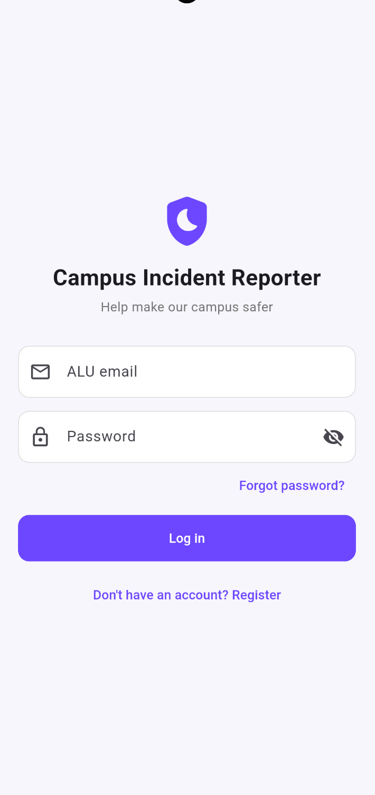{width=35%}

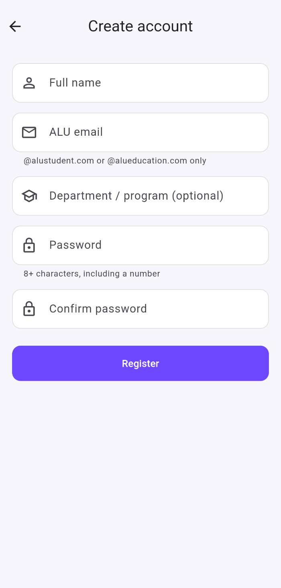{width=35%}

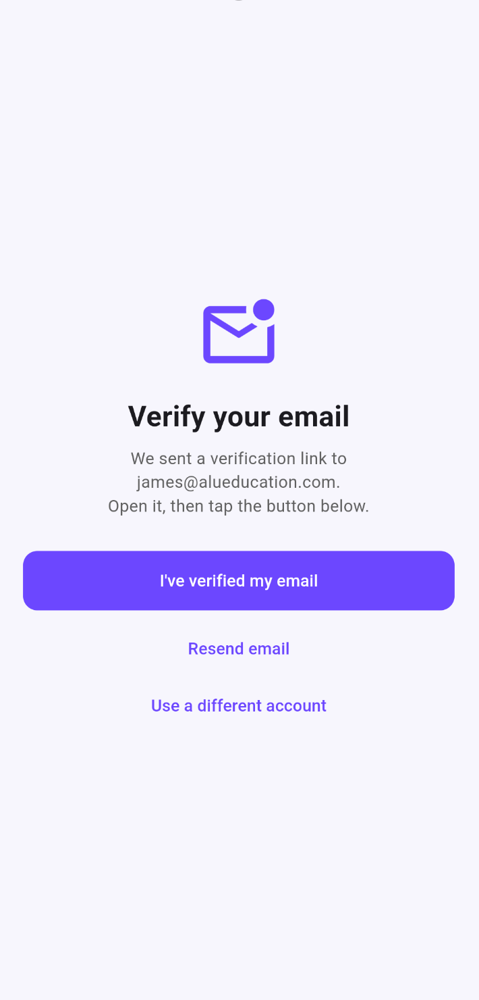{width=35%}

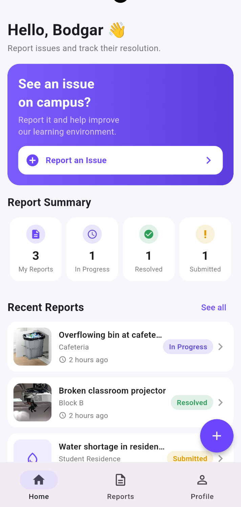{width=35%}

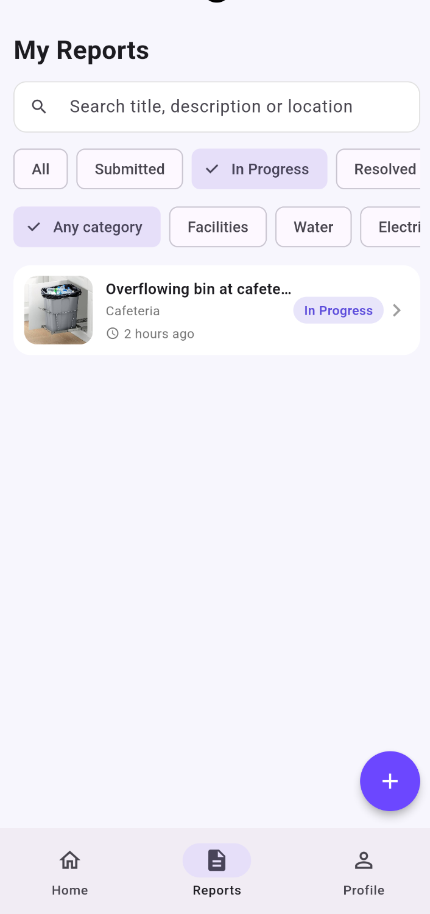{width=35%}

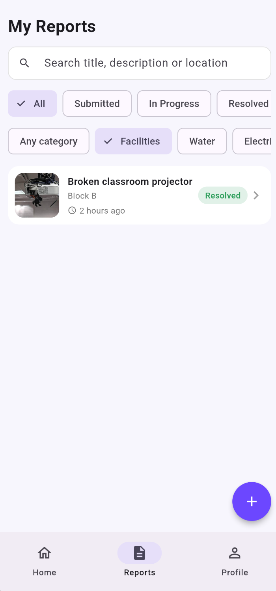{width=35%}

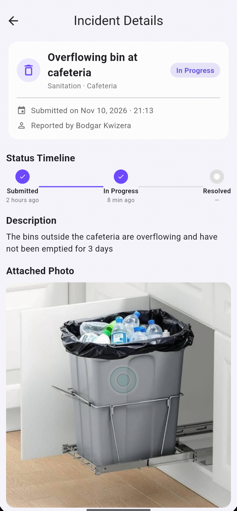{width=35%}

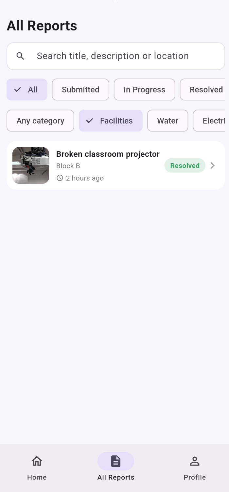{width=35%}

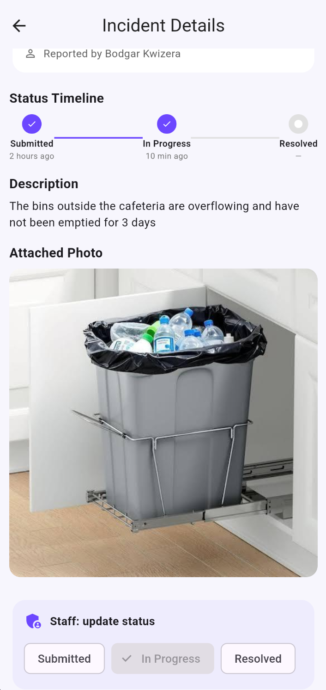{width=35%}

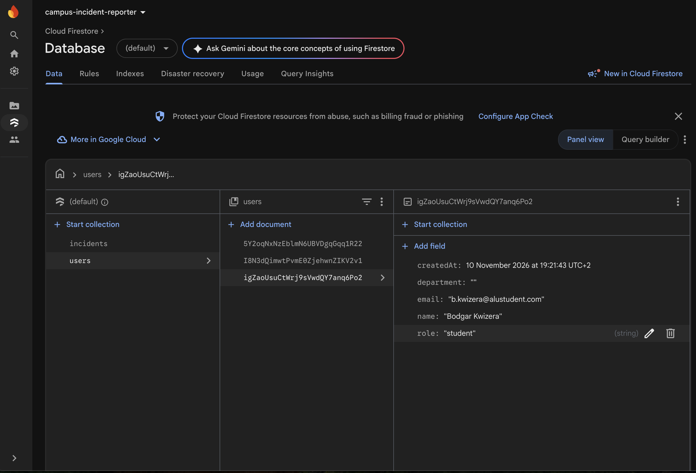{width=35%}

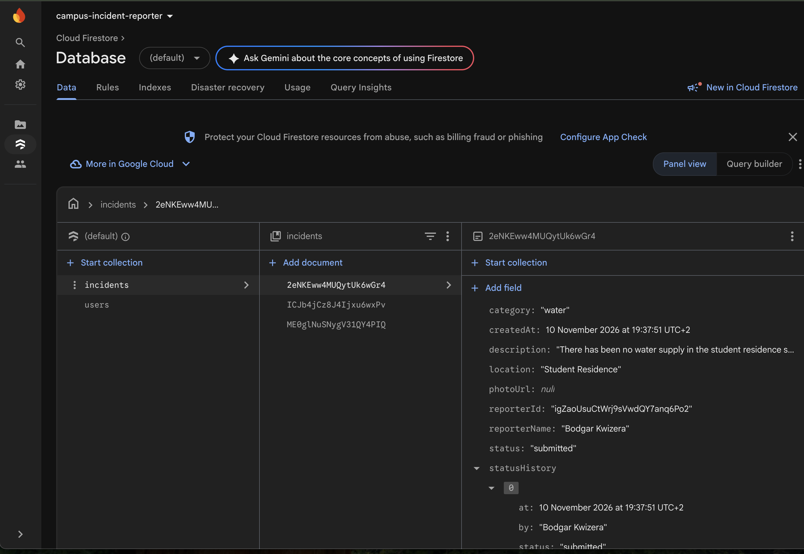{width=35%}

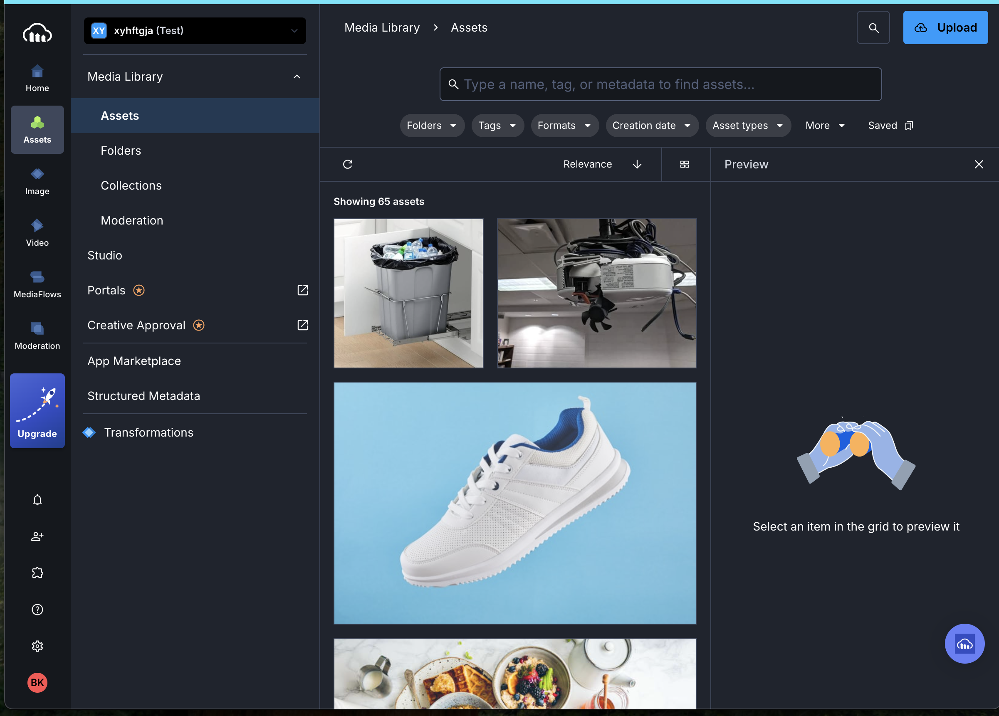{width=35%}

## 7. Testing Strategy
- **Unit tests (`flutter test`, 14 tests):** validators (ALU email rule, password, title, description), `Incident` serialization round-trip, provider filter/search logic, `timeAgo` utility, and Cloudinary upload parsing/error handling with a mock HTTP client.
- **Static analysis:** `flutter analyze` reports no issues.
- **Build verification:** `flutter build apk --debug` succeeds.
- **Manual end-to-end tests** on [emulator/device name]: see the checklist in README.md (registration, verification, submit with photo, filters, edit/delete, staff status update, live propagation).
- **Security tests:** [describe: tried to update `status` as a student and the write was denied; tried registering `role: staff` and it was denied. Add results/screenshots.]

## 8. Challenges and Solutions
| Challenge | Solution |
|---|---|
| Incident stream must change when user logs in/out or role changes | `ChangeNotifierProxyProvider` rebinds the stream; `bind()` notifies after the frame to avoid "setState during build". |
| Preventing students becoming staff | Role never written by the client as staff; rules enforce `role == 'student'` on create and immutability on update. |
| Firestore composite index for `where` + `orderBy` | Sorted student results on the client. |
| Firebase Storage requires the paid Blaze plan | Used Cloudinary free tier with an unsigned upload preset (facilitator approved a free alternative). |
| Deleting images from Cloudinary needs the API secret | Not shipped in the app; the Firestore document is deleted so the image becomes unreachable. A Cloud Function or backend would be needed for true deletion. |
| Email verification state not refreshing | Explicit `reload()` plus provider refresh when the user taps "I've verified". |
| [Add your own: e.g., Firebase setup, Android build time] | [..] |

## 9. Limitations and Future Work
Photo files are not removed from Cloudinary when a report is deleted (needs a backend holding the API secret). Staff roles are assigned manually (an admin UI or Cloud Function with custom claims would be better). No push notifications when status changes. No offline photo queue. Possible additions: comments, upvotes on duplicate reports, location picker, analytics for staff.

## 10. Lessons Learned
Separating repositories from providers made the app easy to test and to explain. Security rules are as important as UI checks. Designing the data model around the queries (single-document timeline, client-side sort) avoided index and read-cost complexity. [Add personal reflections.]

## 11. Conclusion
The app delivers an end-to-end reporting workflow with real-time tracking, role-based access, and a layered, maintainable Flutter/Firebase architecture that meets the assignment requirements.

## References (IEEE)
[1] Google, "Firebase Authentication," Firebase Documentation. [Online]. Available: https://firebase.google.com/docs/auth. [Accessed: Nov. 10, 2026].
[2] Google, "Cloud Firestore," Firebase Documentation. [Online]. Available: https://firebase.google.com/docs/firestore. [Accessed: Nov. 10, 2026].
[3] Cloudinary, "Upload API reference," Cloudinary Documentation. [Online]. Available: https://cloudinary.com/documentation/image_upload_api_reference. [Accessed: Nov. 10, 2026].
[4] Flutter Team, "Simple app state management (Provider)," Flutter Documentation. [Online]. Available: https://docs.flutter.dev/data-and-backend/state-mgmt/simple. [Accessed: Nov. 10, 2026].
[5] Google, "Firebase Security Rules," Firebase Documentation. [Online]. Available: https://firebase.google.com/docs/rules. [Accessed: Nov. 10, 2026].
[6] Flutter Team, "Flutter documentation." [Online]. Available: https://docs.flutter.dev. [Accessed: Nov. 10, 2026].
